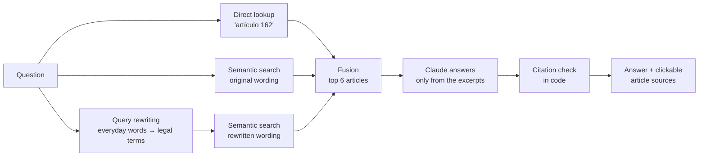

# Asistente de la Ley Federal del Trabajo (RAG)


A retrieval-augmented assistant that answers questions about Mexico's federal labour law (Ley Federal del Trabajo)
in Spanish. Every statement in an answer cites the article it comes from, every citation is checked in code against
the articles actually retrieved, and every cited article can be opened in its official text.
When the law doesn't cover a question, the assistant says so instead of guessing.

*Asistente que responde preguntas sobre la Ley Federal del Trabajo con base en el texto oficial, citando el artículo de cada afirmación.*

Law version: **Última Reforma DOF 14-05-2026**, from the official text published by the Cámara de Diputados.

## How it works



**Ingestion** (`ingest/`): downloads the official PDF (457 pages), cleans page headers, page numbers and reform
annotations, and splits the text into its **1,266 articles** with their Título and Capítulo. The 148 repealed
articles are excluded from search. Long articles are split into pieces at sentence ends (Article 513, which contains
the full occupational-disease tables, becomes 223 pieces), giving **1,422 searchable chunks**.

**Retrieval** (`rag/search.py`): multilingual embeddings (`intfloat/multilingual-e5-base`, run locally), plus a direct
database lookup when a question names an article, plus a second search with the question rewritten into the law's
own vocabulary. Results are combined with Reciprocal Rank Fusion.

**Answering** (`rag/answer.py`): Claude receives the question and the 6 retrieved articles, each tagged with its id,
and must cite every statement as `(Art. N)` using only those articles.

## Design decisions

**Citations are verified in code, not trusted.** After the model answers, the code extracts every formal citation and
checks it against the articles search actually returned. A citation to anything else would mean the model used its own
memory of the law, which may be outdated, and is flagged.

**The disclaimer is added by code.** Early evaluations showed the model sometimes dropped the required
"not legal advice" line, so the code appends it to every answer instead of asking the model to.

**Truncated answers are never shown.** The model reasons before answering, and that reasoning shares the token
budget. An undersized budget produced empty or cut-off answers; the budget was raised and any answer that still runs
out is replaced by a clear message.

**Hybrid search was tested and rejected for this corpus.** Combining keyword (BM25) and semantic search is common
advice, so it was measured at several weights. Every weight made results worse than semantic search alone, so the
keyword search is kept only for comparison in the evaluation.

**The query-rewrite prompt has no examples on purpose.** Adding examples like "despido → rescisión" would have fixed
specific failing evaluation questions, which would be tuning the system to its own test set.

**Parsing the official PDF took real cleaning.** The text mixes two heading styles (`Artículo 47.-` and the newer
`Artículo 22.`), lettered and Latin-numbered articles (`15-A`, `512-D Bis`), a typo in the official text
(`Artículo 890-`), and Article 353-Ñ. Each case is covered by a unit test.

## Evaluation

Run with `python evals/run_evals.py --answers`. Full per-question results are in `evals/results.json`.

**Retrieval**: 44 questions with known correct articles; is a correct article in the top 6?

| Method | hit@6 | MRR |
|---|---|---|
| Keyword (BM25) | 24/44 | 0.327 |
| Semantic | 38/44 | 0.673 |
| Hybrid, keyword weight 1.0 | 36/44 | 0.637 |
| Hybrid, keyword weight 0.25 | 37/44 | 0.670 |
| Semantic + direct lookup | 40/44 | 0.738 |
| **Semantic + direct lookup + query rewriting** (default) | **41/44** | **0.748** |

**Answers**: 50 questions, checked by rules (no LLM judge): the answer cites a correct article, cites nothing that
wasn't retrieved, and declines out-of-scope questions.

| Question type | Passed |
|---|---|
| Normal questions | 37/40 |
| Questions naming an article | 4/4 |
| Out of scope (taxes, IMSS, visas, jokes, prompt injection) | 6/6 |
| **Total** | **47/50** |

How the answer score developed: 25/50 on the first run, then 44/50 (direct lookup, disclaimer in code, stricter
citation format), 45/50 (larger reasoning budget) and 47/50 (query rewriting, off-topic rule).

## Known limitations

- The three remaining failures are retrieval misses (Arts. 74/75, 110 and 117). In each case the assistant answers
  only what the retrieved articles support and says what it couldn't find, rather than inventing it.
- All tuning was checked against the same 50 questions. A fresh, held-out question set is the next step for an
  unbiased measure.
- The assistant reflects one version of the law. Re-running the ingestion pipeline picks up later reforms.
- It gives general information, not legal advice.

## Setup

Requires Python 3.11 and an Anthropic API key.

```
git clone https://github.com/matajaller/lft-rag-asistente.git
cd lft-rag-asistente
pip install -r requirements.txt
```

Copy `.env.example` to `.env` and add your key. Then build the data (the law is downloaded, not stored in the repo):

```
python ingest/download_and_extract.py
python ingest/split_articles.py
python ingest/build_index.py
python ingest/embed_chunks.py
```

Start the web chat and open http://127.0.0.1:8000:

```
uvicorn server:app --reload --app-dir rag
```

Unit tests: `pytest -v` (no API key or model needed).

## Project structure

```
ingest/   download, clean, split into articles, chunk, embed
rag/      search, query rewriting, answering, web server
web/      chat page
evals/    question set and evaluation runner
tests/    unit tests (parsing, references, citation checking)
```

## Tech

Python · Claude API · sentence-transformers (multilingual-e5) · SQLite (FTS5) · NumPy · FastAPI · pytest · GitHub Actions
